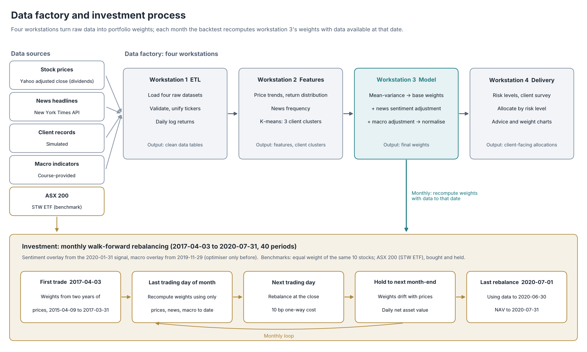

# ASX Asset Management

[中文](README.md) | English

An asset allocation pipeline for ten large ASX stocks: mean-variance optimisation sets the base weights, news sentiment and macro indicators adjust them, and a monthly walk-forward backtest tests the rules using only the data available at each rebalance.

## Performance


| 2017-04-03 to 2020-07-31 | Full strategy | Equal weight (same 10 stocks) | ASX 200 |
|---|---|---|---|
| Total return | 87.5% | 67.9% | 14.9% |
| Annualised return | 20.8% | 16.9% | 4.3% |
| Annualised volatility | 16.1% | 15.6% | 17.0% |
| Sharpe ratio (net of RBA cash rate) | 1.18 | 1.00 | 0.26 |
| Maximum drawdown | −17.9% | −20.3% | −34.3% |
| Excess return vs equal weight, p.a. (t-stat) | +3.4% (0.9) | — | — |
| Excess return vs ASX 200, p.a. (t-stat) | +14.5% (2.1) | +11.1% (2.4) | — |

- **The allocation model's own contribution is not statistically significant.** Against an equal-weight portfolio of the same ten stocks, the strategy earned 3.4 percentage points a year more, with a t-statistic of about 0.9. It beat equal weight in only 21 of 40 months and trailed it by 8.1 points in 2019.
- **Beating the ASX 200 came mostly from the stock universe.** The ten stocks are a fixed list set at the end of the sample, which builds in hindsight selection bias: holding them in equal weight already beat the index by 11.1 points a year, so the +14.5% is not evidence of skill.
- **Smaller drawdown in the 2020 crash.** From 20 February to 23 March 2020 the strategy, equal weight and the ASX 200 fell 13.9%, 19.9% and 34.3%; in the rebound to 31 July they rose 19.3%, 20.8% and 28.3%. A single episode does not show a reliable defensive edge.
- **The sentiment and macro overlays cannot be evaluated yet.** News and macro data cover only the last months of the sample, so the overlays were active in only 6 and 8 of the 40 periods.

## Method



- **Data:** dividend-adjusted daily closes from Yahoo Finance for BHP, CSL, RIO, CBA, WOW, WES, TLS, AMC, BXB and FPH (2015-03-30 to 2020-07-31); 405 headlines from the New York Times API; monthly Australian macro indicators provided by the course; 100 simulated clients. The STW ETF stands in for the ASX 200, and the Reserve Bank of Australia (RBA) cash rate is the risk-free rate.
- **Portfolio:** each month, maximise expected return − 4.34 × volatility (risk level 2) over the last 504 trading days, long-only and fully invested; then add a news-sentiment adjustment (VADER scores on headlines) and a macro adjustment (a per-stock OLS regression on six indicators) and renormalise.
- **Backtest:** compute weights on the last trading day of each month, trade at the next day's close with a 10 bp one-way cost, and hold to the next month-end; 40 periods. Equal weight is rebalanced monthly under the same rules; the ASX 200 is bought on the first trade date and held.
- **No look-ahead:** prices up to the signal-day close, headlines published before 16:00 Sydney time on the signal day, and macro data with a two-month release lag. A unit test alters all data after the signal date and checks that the weights do not change.

## Limitations and next steps

- **Universe:** use point-in-time ASX 200 constituents to remove the selection bias.
- **Sample length:** 40 months that include one crash and rebound. At an information ratio of about 0.5, it would take about 16 years of data for the excess return over equal weight to reach a t-statistic of 2.
- **Model design:** mean-variance weights are sensitive to estimation error; the macro regression fits six coefficients on 7–14 monthly observations and is prone to overfitting; adding the overlays and renormalising produced negative weights in 4 periods, with no borrowing cost charged.
- **Attribution:** excess returns are not yet decomposed into market, size and sector exposures.

## Run

With Python 3.12:

```bash
python -m pip install -r requirements.txt
python -m nltk.downloader vader_lexicon
python main.py --mode backtest --data-dir data   # backtest -> outputs/backtest/
python main.py --data-dir data                   # full pipeline -> outputs/
python -m unittest discover -s tests             # 32 tests
```

The [full project report](docs/report.md) (in Chinese) documents the data, the four workstations and the early report's results, and details the backtest method, results and limitations; [methodology](docs/methodology.md) (in Chinese) covers implementation details.

## Licence

My code is licensed under the [Apache License 2.0](LICENSE), which does not cover the data in `data/`: Yahoo Finance prices, New York Times headlines, simulated client records, course-provided macro indicators and RBA cash rates remain with their owners, so check the source terms before using or redistributing them. The synthetic samples in `data/sample/` were made by me. Each file is described in [data/README.md](data/README.md) (in Chinese).
