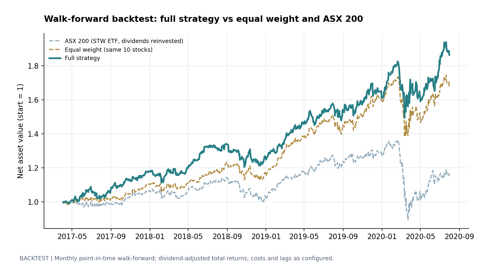
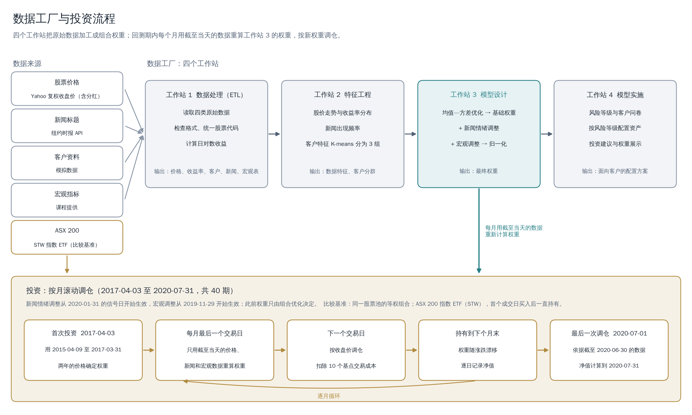

# ASX Asset Management

[English](README.md) | 中文

我用 10 只 ASX 大盘股搭建了一套资产配置流程：先用均值—方差优化得到基础组合，再根据新闻情绪和宏观指标调整权重，最后用按月滚动回测检验，每次调仓只使用当时已经可以获得的数据。

## 投资收益表现



| 2017-04-03 至 2020-07-31 | 完整策略 | 等权组合（同 10 只股票） | ASX 200 |
|---|---|---|---|
| 总收益 | 87.5% | 67.9% | 14.9% |
| 年化收益 | 20.8% | 16.9% | 4.3% |
| 年化波动 | 16.1% | 15.6% | 17.0% |
| 夏普比率（扣除 RBA 现金利率） | 1.18 | 1.00 | 0.26 |
| 最大回撤 | −17.9% | −20.3% | −34.3% |
| 相对等权组合的年化超额收益（t 值） | +3.4%（0.9） | — | — |
| 相对 ASX 200 的年化超额收益（t 值） | +14.5%（2.1） | +11.1%（2.4） | — |

- **配置模型本身的贡献在统计上不显著。** 与持有同样 10 只股票的等权组合相比，完整策略每年多 3.4 个百分点，t 值约 0.9；40 个月中只有 21 个月跑赢，2019 年还落后 8.1 个百分点。
- **跑赢 ASX 200 主要靠股票池。** 这 10 只股票是样本期末确定的固定名单，带有事后选股偏差：等权持有就比 ASX 200 每年多 11.1 个百分点，因此 +14.5% 不能视为模型的能力。
- **2020 年初回撤较小。** 2020 年 2 月 20 日至 3 月 23 日，完整策略、等权组合和 ASX 200 分别下跌 13.9%、19.9% 和 34.3%；到 7 月底的反弹中分别上涨 19.3%、20.8% 和 28.3%。这只是一次事件，不足以说明策略有稳定的防守能力。
- **情绪与宏观调整还无法评估。** 新闻和宏观数据只覆盖回测期的最后几个月，两类调整分别只在 40 期中的 6 期和 8 期生效。

## 方法



- **数据：** BHP、CSL、RIO、CBA、WOW、WES、TLS、AMC、BXB、FPH 在 2015-03-30 至 2020-07-31 的 Yahoo Finance 复权收盘价（含分红）；通过纽约时报 API 获取的 405 条新闻标题；课程提供的澳大利亚月度宏观指标；100 位模拟客户。ASX 200 用指数 ETF（STW）代表，无风险利率用澳洲储备银行（RBA）的现金利率。
- **组合：** 用最近 504 个交易日的收益做均值—方差优化，最大化“预期收益 − 4.34 × 波动率”（风险等级 2），不做空、资金全部投入；再加上新闻情绪调整（VADER 标题评分）和宏观调整（每只股票对 6 个指标做 OLS 回归），归一化后得到最终权重。
- **回测：** 每月最后一个交易日计算权重，下一个交易日按收盘价调仓，单边成本 10 个基点，持有到下个月末，共 40 期。等权组合按同样的规则每月调仓；ASX 200 在首个成交日买入后一直持有。
- **不使用未来数据：** 价格截至信号日收盘，新闻截至信号日悉尼时间 16:00，宏观指标按 2 个月的发布滞后使用。单元测试篡改信号日之后的全部数据，确认当期权重不变。

## 局限与改进方向

- **股票池：** 改用各时点的 ASX 200 成分股，消除事后选股偏差。
- **样本长度：** 40 个月中包含 2020 年的一次暴跌和反弹。按约 0.5 的信息比率，需要约 16 年的数据，相对等权组合的 t 值才能达到 2。
- **模型设计：** 均值—方差权重对收益估计误差敏感；宏观回归每期只有 7–14 个月度样本，却要估计 6 个系数，容易过拟合；两类调整相加后再归一化，有 4 期出现负权重，回测没有计入借券成本。
- **收益归因：** 还没有把超额收益分解到市场、规模和行业等因子上。

## 运行方法

使用 Python 3.12：

```bash
python -m pip install -r requirements.txt
python -m nltk.downloader vader_lexicon
python main.py --mode backtest --data-dir data   # 滚动回测，结果写入 outputs/backtest/
python main.py --data-dir data                   # 完整流程（四个工作站），结果写入 outputs/
python -m unittest discover -s tests             # 32 个测试
```

[完整项目报告](docs/report.md)按四个工作站记录数据、计算方法和早期报告的结果，并详细说明回测方法、结果明细与局限；[方法与限制](docs/methodology.md)说明当前代码的实现细节。

## 许可

我编写的代码采用 [Apache License 2.0](LICENSE)。该许可只适用于代码，不适用于 `data/` 中的数据：Yahoo Finance 的复权价格 `ASX200top10_yahoo.csv` 和 `ASX200_STW_yahoo.csv`（及其下载记录）、通过纽约时报 API 获取的新闻记录 `news_dump.json`、模拟的客户资料 `Client_Details.xlsx`、课程提供的宏观指标 `Economic_Indicators.xlsx`，以及澳洲储备银行的现金利率 `RBA_cash_rate.csv`（及其下载记录）。

这些数据的权利归原权利人所有，Apache License 2.0 不授予这些数据的任何权利；使用或再分发前需确认原始来源的条款。`data/sample/` 中的模拟样本由我构造，不包含真实股票、客户或新闻记录。
