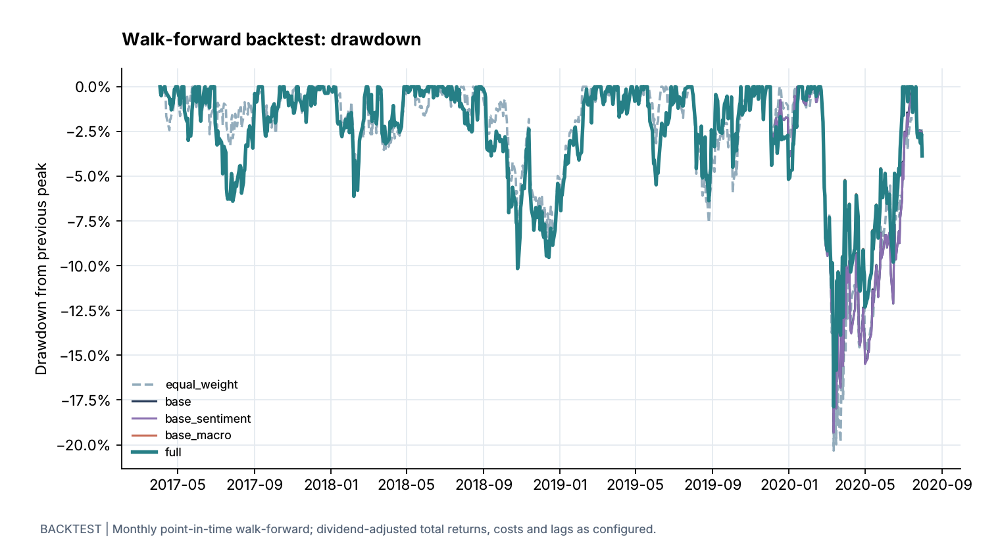

# ASX Asset Management 项目报告

[README](../README.md)（[English](../README.en.md)）是项目的一页概要；这份报告是完整版本，按数据工厂的四个工作站记录数据来源、计算方法和早期报告的结果，并说明滚动回测的方法、[结果明细](#结果明细)与局限。当前代码的实现细节见[方法与限制](methodology.md)。

## 数据来源与说明

### 数据一览

| 数据 | 文件 | 来源 | 时间范围 | 用途 |
|---|---|---|---|---|
| 股票价格 | `data/ASX200top10_yahoo.csv` | Yahoo Finance 复权收盘价（含分红和拆股调整），由 `scripts/fetch_yahoo_prices.py` 下载 | 2015-03-30 至 2020-07-31，1,354 个交易日 | 收益计算、组合优化、宏观回归、回测净值 |
| ASX 200 | `data/ASX200_STW_yahoo.csv` | Yahoo Finance：ASX 200 指数 ETF（STW）的复权收盘价，下载方式同上 | 2015-03-30 至 2020-07-31 | 回测的比较基准 |
| 无风险利率 | `data/RBA_cash_rate.csv` | 澳洲储备银行（RBA）网站：每次议息会议决定的现金利率目标，由 `scripts/fetch_rba_cash_rate.py` 下载 | 1990 年起；回测期内从 1.50% 降至 0.25%，平均约 1.21% | 计算夏普比率 |
| 新闻标题 | `data/news_dump.json` | 纽约时报 API | 2020-01-30 至 2020-07-30，405 条 | 新闻情绪调整 |
| 客户资料 | `data/Client_Details.xlsx` | 模拟数据，不含真实客户信息 | 100 位客户 | 客户分群 |
| 宏观指标 | `data/Economic_Indicators.xlsx` | 课程提供的澳大利亚月度经济指标 | 2019 年 1 月起，多数到 2020 年 6 月，共 18 个指标 | 宏观回归与调整 |
| 模拟样本 | `data/sample/` | 我构造的虚构数据 | — | 演示模式 |

10 只股票为 BHP、CSL、RIO、CBA、WOW、WES、TLS、AMC、BXB、FPH。各文件的字段和读取规则见[数据说明](../data/README.md)。

### 数据处理约定

- **含分红的总收益：** 价格使用复权收盘价，分红视为再投资。早期版本使用 Bloomberg 导出的 `PX_LAST`，不含分红，会高估低配高股息股票的组合表现，现已替换。
- **真实交易日历：** 只保留 ASX 实际交易日，不为休市日补价格；缺失价格保留为空，不以零代替。
- **按发布时间使用数据：** 回测中，新闻只使用信号日悉尼时间 16:00 之前发布的标题；宏观指标按 2 个月的发布滞后使用。
- **无风险利率：** 夏普比率扣除当日已生效的 RBA 现金利率目标，按每年 252 个交易日折算为日利率。
- **授权：** 代码采用 Apache License 2.0，数据不在授权范围内，见[许可](#许可)。

## 数据工厂

数据工厂把原始数据逐步加工成组合权重，再按这些权重投资。它由四个工作站组成，前一个工作站的输出是后一个工作站的输入。回测期内，每个月都用截至当天的数据重新计算一次权重：工作站 1 整理数据，工作站 3 计算组合；工作站 2 的客户分群不影响权重。


| 工作站 | 做什么 | 输入 | 输出 |
|---|---|---|---|
| 1. 数据处理（ETL） | 读取原始数据，检查格式，整理成统一的表格 | 价格、客户、新闻、宏观四类原始数据 | 价格与收益率表、客户特征表、新闻表、月度指标表 |
| 2. 特征工程 | 提取并可视化数据特征，按持仓对客户分群 | 工作站 1 的各类表格 | 走势与收益分布特征、新闻频率、客户分群 |
| 3. 模型设计 | 优化组合，并根据新闻情绪和宏观指标调整权重 | 收益率、新闻、宏观指标 | 有效前沿、基础权重、两类调整、最终权重 |
| 4. 模型实施 | 把模型做成面向客户的产品和服务流程 | 最终权重与风险等级 | 按风险等级的配置方案、投资建议与展示 |

**怎样做投资：**

1. **确定第一组权重：** 用 2015-04-09 至 2017-03-31 两年的价格，经工作站 1 整理、工作站 3 组合优化算出权重，2017-04-03 按收盘价买入。这时还没有新闻和宏观数据，两类调整为零。
2. **每月重新计算：** 此后每个月最后一个交易日，只用截至当天已经可以获得的价格、新闻和宏观数据，重新计算工作站 3 的基础组合、情绪调整和宏观调整，得到新的目标权重。
3. **下一个交易日调仓：** 按收盘价调到新权重，扣除 10 个基点的交易成本；到下个月末之前不再交易，权重随涨跌漂移。
4. **逐月循环到结束：** 最后一次调仓在 2020-07-01，净值计算到 2020-07-31，共 40 期。全程与两个基准比较：同一股票池的等权组合（同样每月调仓并扣除成本）和买入并持有的 ASX 200。
5. **工作站 4 不参与回测：** 它把同样的模型做成面向客户的产品，按客户的风险等级给出配置。

| 项目 | 时间 |
|---|---|
| 价格数据 | 2015-03-30 至 2020-07-31，Yahoo Finance 含分红的复权收盘价 |
| 首次投资 | 2017-04-03，权重由 2015-04-09 至 2017-03-31 两年的价格确定 |
| 每月调仓 | 每月最后一个交易日，用最近两年的价格，以及当时已经发布的新闻和宏观指标重算权重，下一个交易日调仓 |
| 最后一次调仓 | 2020-07-01（依据截至 2020-06-30 的数据），净值计算到 2020-07-31，共 40 期 |
| 新闻与宏观数据 | 情绪调整从 2020-01-31 的信号日开始生效，宏观调整从 2019-11-29 的信号日开始生效；在此之前，权重只由组合优化决定 |

各工作站中的图片来自我的早期项目报告，保留当时的结果。当时的价格为 Bloomberg 导出的 `PX_LAST`（不含分红），与当前代码使用的 Yahoo 含分红价格不同。文中的“研究说明”用来区分当时的判断与当前解释。完整原文见[中文版报告](project-summary-zh.md)（[PDF](project-summary-zh.pdf)）和[英文原版报告](project-summary.pdf)。代码运行环境为 Python 3.12。

## 工作站 1：数据处理（ETL）

### 简介

> 批注 [渭何1]: 抓取、转化、提炼数据。加载不同形式的
> 数据流，通过网站提供的 API 得到数据，处理成为后续
> 想要的数据形式。

ETL 是 Extract、Transform、Load 的缩写，即提取、转换和加载：从不同来源提取数据，转换为统一格式，再加载为后续分析可以直接使用的表格。这个工作站读取四类原始数据，检查格式，并整理成统一的数据框。

### 计算方法

输入的四类原始数据如下（早期报告截图）：


- **股票价格：** 读取复权收盘价，按日期排序，检查日期唯一、价格为正；缺失价格保留为空，不以零代替。
- **收益率：** 日对数收益 = ln(当日价格 / 前一日价格)；月收益用每月最后一个有效价格计算简单收益。计算日收益时不跨越缺失价格，只保留所有股票都有收益的日期。
- **客户资料：** 读取 `Data` 工作表，以 `client_ID` 为索引，要求编号唯一、字段为完整的数值；持仓列中的股票标签统一为股票代码。
- **新闻：** 读取 JSON，保留 `Equity`、`Source`、`Date/Time`、`Headline` 四个字段，股票标签统一为股票代码。
- **宏观指标：** 读取工作表中的 `Monthly Indicators` 区域，转置为“月份 × 指标”的表格，日期统一到自然月末。

早期报告在这一步还做了两项计算：用 2015—2020 年的价格计算十只股票的平均日收益率，以及按随机权重投资十只股票的加权平均收益率；按条件分别筛选客户记录（风险等级为 4 及以上、年龄组编号小于 4、CSL 在资产配置中的比例超过 50%）。

> 研究说明：我在早期报告的小标题中写作“ASX200top20”，实际输入文件为 `ASX200top10.xlsx`，分析对象是十只股票。

### 数据输出

- 十只股票的价格表和日收益率表，以及十只股票的预期平均收益；
- 客户特征表（100 位客户）、新闻表（405 条）和月度宏观指标表。


## 工作站 2：特征工程

### 简介

> 批注 [渭何2]: 数据挖掘、数据可视化。1. 将资产的特征
> 提取出来，利用统计学的方法可视化数据特征。2. 根据
> 客户现有资产头寸，结合聚类分析算法，自动判断客户
> 风险偏好类型。

特征工程是利用领域知识，把原始数据转换成有意义的变量，例如新建或修改数据列、组合不同来源的数据、对类别变量编码，为后续模型提供扎实、相关的输入。这个工作站在工作站 1 的结果上提取并可视化数据特征，并根据客户持仓对客户分群。

### 计算方法

- **股票走势：** 把十只股票的价格画在同一张图中，比较各自的涨跌和波动。
- **收益率分布：** 绘制日收益率的分布图和 QQ 图，并用正态性检验判断收益率是否接近正态分布。
- **客户分布：** 统计客户的年龄组和风险偏好分布。
- **新闻频率：** 统计每家公司在新闻中出现的次数。
- **客户分群（K-means）：** 去掉风险等级和已有的分组标签，其余持仓特征先用 `StandardScaler` 标准化，再用 K-means 分为 3 组；随机种子为 42，初始化 10 次，以便复现。

当前代码实现了收益率计算和客户分群；走势图、收益率分布、QQ 图和正态性检验是早期报告中完成的分析。

### 数据输出

**股票走势：** 过去五年平均股价总体呈上升趋势，其中 CSL 涨幅最大。我当时根据图中的波动判断，波动较大的股票似乎涨幅也更大，并把这一现象与“风险越高、回报越高”的投资理念联系起来。


> 研究说明：这里记录的是我对历史图形的观察，不能据此推断高波动必然带来更高的实际收益，也不能把这段样本中的关系视为未来表现的保证。

**收益率分布：**


我在早期报告中将检验结果解释为“投资收益率满足正态分布（P 值 < 0.05）”。

> 研究说明：我在此保留当时的判断记录。对于以“数据服从正态分布”为原假设的正态性检验，`p < 0.05` 应表示在 5% 显著性水平下拒绝正态性假设，不能用来证明收益率服从正态分布；`p ≥ 0.05` 也不能证明正态性。我的当前解释见[方法与限制](methodology.md)。

**年龄与风险偏好的分布：**


**新闻出现频率：** 市值较大的公司被讨论得更多。


**客户分群：** K-means 将客户分为三组：簇 0 有 52 位客户，簇 1 有 25 位，簇 2 有 23 位。


- **簇 0：** 平均年龄组编号最高，约为 3.29；在不同股票之间的配置较均衡。这一簇可能代表年龄较大的客户，投资更分散，倾向于稳定的投资。
- **簇 1：** 平均年龄组编号约为 2.48；对 RIO AT Equity 的投资比例明显高于其他股票。我在报告中将其解释为可能寻求特定行业或公司较高收益的资深客户。
- **簇 2：** 平均年龄组编号最低，约为 1.57；对 BHP AT Equity 的投资比例很高，几乎没有投资 BXB AT Equity 和 FPH AT Equity。这可能反映一个较年轻、投资高度集中于单只股票或单一行业的客户群体。

## 工作站 3：模型设计

### 简介

> 批注 [渭何3]: 1. 蒙特卡洛模拟
> 2. 最优化资产组合模型
> 3. ARIMA 判断股指
> 4. 基于 NLP 模型的市场情感分析

这个工作站接收前两个工作站的结果，建立模型为客户配置投资组合，并根据经济指标和市场新闻调整资产配置。

> 研究说明：我在早期报告的定义中将输入来源写为“工作站 3”；按照四个工作站的处理顺序，这里应理解为接收前序的数据处理与特征工程结果。

### 计算方法

1. **蒙特卡洛模拟：** 随机生成 5,545 组权重（非负、合计为 1，随机种子 5545），用历史收益的均值和协方差计算每组的年化收益、年化波动率和收益波动比，展示没有优化算法时可能得到的组合分布。（Harrison, 2010）
2. **均值—方差优化（基础组合）：**
   - 年化预期收益 = 日均对数收益 × 252，年化协方差 = 日收益协方差 × 252；
   - 目标：最大化“组合预期收益 − 风险惩罚系数 × 组合波动率”，风险惩罚系数 = 11 − 3.33 × 风险等级；项目采用风险等级 2，系数为 4.34；
   - 约束：每只股票的权重在 0 到 1 之间（不做空），权重合计为 1；用 SciPy 的 SLSQP 算法从等权组合出发求解；
   - 同时求解最大收益波动比组合、最小方差组合，以及给定目标收益下波动率最小的有效前沿。（Bailey & , 2012）
3. **新闻情绪调整：** 用 NLTK 的 VADER 给每条标题打分，策略评分 = 正面分 − 负面分 + 0.1 × 中性分；对每只股票计算“最近 5 条新闻的平均分 − 全部新闻的平均分”，除以 10 作为权重调整量。正面新闻被视为利好股价，负面新闻被视为可能导致股价下跌。（Chowdhury, et al., 2014）
4. **宏观调整：** 对每只股票分别做不含截距的 OLS 回归：因变量为股票月度收益，解释变量为 6 个宏观指标的变化率（货币供应量 M1、消费者信心指数、贸易差额、TD-MI 通胀指标、招聘广告、零售销售）。用最近 3 个月的平均变化率预测收益，再减去基准项（最近一期消费者信心变化率 × (1 + 近期平均变化率)），作为权重调整量。
5. **合并权重：** 最终权重 = (基础权重 + 情绪调整 + 宏观调整) ÷ 三者合计。这一步不再限制权重非负，可能出现负权重。
6. **ARIMA（独立实验）：** 用 ARIMA 预测市场指数走势，结果不参与最终权重。

> 研究说明：早期报告把宏观经济 OLS 回归写在“NLP（与 OLS 模型结合）”这一标题下。当前实现中，宏观回归与 NLP 新闻情绪分析是两个独立模块，NLP 模块本身不使用 OLS，具体计算见[方法与限制](methodology.md)。

### 模型假设与边界

- **市场有效性：** 资产价格已经反映所有可获得的信息；这是使用有效前沿和蒙特卡洛模拟进行投资决策的基础假设。
- **风险偏好可以量化：** 投资者的风险偏好可以被准确量化，并映射到具体的组合策略，例如最大夏普比率或最小方差组合。
- **情绪分析准确：** 财经新闻的情绪分数能够反映市场情绪，并且对股价的影响具有一定的可预测性；这是用情绪调整权重的前提。
- **计算速度：** 当前模型只用于十只股票；股票数量或模拟次数增加时，蒙特卡洛模拟等步骤的计算速度会下降。
- **准确性与敏感性：** 模型的准确性受市场有效性、收益率正态分布等假设影响；实际数据偏离这些假设时，组合可能偏离最优。模型也对新闻情绪、经济指标等输入的准确性较为敏感。
- **约束条件与变量边界：** 权重合计必须为 1，保证资金全部投入；每只股票的权重在 0 到 1 之间，避免做空。
- **最优风险组合曲线：** 用来描述风险与收益的边界。现实中投资者无法以无风险利率无限借款，因此这里不讨论借款投资或只投入部分资金的情形。

> 研究说明：`0 ≤ weight ≤ 1` 仍允许全部资金配置到一只股票，因此这组边界并没有建立真正的分散化限制。并且，当前实现只在基础组合优化时施加非负边界，加入两类调整后的最终权重可能为负，详见[方法与限制](methodology.md)。

### 数据输出

- 蒙特卡洛结果 `simulations.csv`、优化组合指标 `portfolio_metrics.csv`、有效前沿 `frontier.csv`；
- 新闻情绪评分 `sentiment_scores.csv`、宏观回归诊断 `macro_diagnostics.csv`；
- 最终配置 `allocations.csv`：每只股票的基础权重、情绪调整、宏观调整和最终权重。

运行完整流程后，这些表格保存在 `outputs/tables/`，图表保存在 `outputs/figures/`。以下是早期报告中的结果：


> 研究说明：新闻情绪与股价方向之间的关系是我在此采用的建模假设；这两张历史结果图本身不能证明情绪评分对未来收益具有预测能力。

## 工作站 4：模型实施

### 简介

> 批注 [渭何4]: 产品落地实施：1. 提供不同的产品给不同
> 风险偏好的客户。设计产品结构、销售渠道、广告、客
> 户群体分析、提供投资咨询建议。2. figma 体现整体的
> 产品结构，吸引客户。

这个工作站把模型结果呈现给客户。我根据工作站 3 的模型设计低、中、高三类风险的资产配置，并设计一套服务客户的工作流程。我认为这一步可能比设计模型更难：需要把复杂的金融理论讲得让客户能够理解，而且仅有模型本身并不足以吸引客户。

### 实施方法

**风险类别：**

| 风险类别 | 客户特征 | 对应模型设置 |
|---|---|---|
| 低风险组 | 偏好稳定和较低波动，愿意接受较低收益 | 风险等级 1，惩罚系数 7.67，更看重低波动；可以把降低波动率作为目标 |
| 风险中性组 | 希望在风险与收益之间取得平衡 | 风险等级 2，惩罚系数 4.34 |
| 高风险组 | 愿意接受较大波动，以争取更高收益 | 风险等级 3，惩罚系数 1.01，几乎只追求高收益；可以用夏普比率衡量相对于波动的收益 |

在每个风险组内部，我计划再根据具体客户的偏好、市场情绪和经济指标（如 GDP 增长率、失业数据、消费者信心）微调组合。例如，风险中性组的某位客户愿意接受略高风险时，可以增加风险较高资产的比例；市场情绪积极时，可以提高相关股票的权重。

**实施步骤：**

1. **设计产品结构：** 开展市场调研，了解市场趋势、潜在竞争者和客户需求；设置高、中、低三个风险等级，并为每个等级制定分散化的策略与资产配置。
2. **广告推广：** 通过数字营销、社交媒体和可能的传统广告渠道，突出个性化风险管理、易用性等特点，面向职场人士、退休人士和寻求创新工具的成熟投资者。
3. **客户问卷与访谈：** 用问卷收集客户的投资经验、风险承受能力、财务目标与偏好；选择部分潜在用户深入访谈，了解他们对投资工具的需求。
4. **提供建议：** 根据问卷与访谈结果，提供与客户风险特征、财务目标相符的个性化投资建议。
5. **选择股票：** 客户从经过筛选、覆盖不同行业和风险类别的股票列表中选择投资标的。
6. **根据模型配置资产：** 按客户最终确定的风险偏好，用资产配置模型把资金分配到选定股票，综合考虑预期收益、风险和客户的投资策略。
7. **给出投资建议与最终权重：** 向客户展示各只股票的最终投资权重，并用柱状图、饼图等方式说明资金的分布。

**向客户介绍产品：** 依次介绍有效前沿（给定风险下争取最优收益）、解释夏普比率（每单位风险对应的收益）、评估客户的财务目标与风险承受能力、匹配资产配置、定期优化组合，最后提供可以执行的策略建议。

**客户旅程：**

1. **发现服务：** 客户通过线上广告或销售接触了解服务，被个性化投资策略吸引。
2. **加入服务与风险画像：** 客户填写问卷或参加访谈，明确财务目标与风险偏好。
3. **选择股票：** 客户选择自己感兴趣的十只股票，我提供说明和学习资料。
4. **通过模型配置资产：** 我根据客户所选股票和风险特征配置资产，并解释配置过程。
5. **监控与调整：** 持续监控组合，响应市场变化或客户目标的变化，并与客户沟通调整情况。
6. **收集反馈与改进：** 定期收集反馈，改进服务。
7. **建立长期关系：** 通过稳定的服务表现和客户满意度，维持长期关系。

**遇到的问题：**

- 我尝试用 ARIMA 预测整体指数时，发现指数和股票价格不是平稳的时间序列，当时的实验没有得到有效的预测结果；而且 ARIMA 是单变量模型，不能直接把其他股票价格的变化作为输入来预测指数。其他模型经常无法成功运行，因此报告中只使用了 ARIMA。
- 解释配置原因时，需要介绍最优风险配置、有效前沿等较多专业金融知识，客户未必能够理解资产为什么这样配置。

> 研究说明：价格序列非平稳并不意味着 ARIMA 原则上无法使用；ARIMA 中的差分部分正是用于处理某些非平稳性，是否适用仍需检验差分后的序列和预测误差。包含额外解释变量的扩展模型也需要另行设计、验证，不能把当时的单变量实验直接当作这类模型的结论。

### 数据输出

- 按风险等级给出的最终投资权重，用柱状图（`outputs/figures/allocation.png`）、饼图等方式呈现；
- 数据处理与结果输出的流程图，具体见 Figma 设计文件。

> 研究说明：这里保留我的报告中对 Figma 设计的描述。目前仓库没有附上该 Figma 文件，也没有可核验的设计链接。

## 回测方法

滚动回测（walk-forward backtest）按时间顺序逐期模拟策略：在每个决策时点，只用当时已经可以获得的信息计算持仓，再用之后真实发生的行情检验这些持仓的表现。与在全部历史数据上一次性计算权重相比，它避免了使用未来信息，并计入交易时点和交易成本，因此更接近策略实际执行时的结果。回测实现位于 `asset_management/backtest.py`。

### 时间安排

时间概览见[数据工厂](#数据工厂)中的时间表，具体规则如下：

- **信号日与成交日：** 信号日为每个月最后一个有价格的交易日，成交日为其后第一个交易日。
- **第一期：** 组合优化需要 504 个交易日的历史收益，因此第一个信号日为 2017-03-31（优化窗口为 2015-04-09 至 2017-03-31），首次成交在 2017-04-03。
- **最后一期：** 价格数据在 2020-07-31 结束，最后一个信号日为 2020-06-30，在 2020-07-01 成交；7 月 31 日的信号要到 8 月才能成交，超出价格数据，因此不生成。共 40 期。
- **净值区间：** 从 2017-04-03 逐日计算到 2020-07-31。
- **两类调整生效时间：** 情绪调整从 2020-01-31 的信号日开始（此前没有新闻）；宏观调整考虑 2 个月发布滞后和回归所需的月数，从 2019-11-29 的信号日开始。此前权重只由组合优化决定。

### 方法步骤

```text
 3 月最后一个交易日（信号日）     下一个交易日（成交日）          4 月最后一个交易日（信号日）
          │                              │                              │
 收盘后只用截至此刻的数据         按收盘价调到新权重；              重新计算，逐月循环
 重新计算目标权重                 当天涨跌仍归属原持仓
```

1. **每月定一次权重：** 每个月最后一个交易日（信号日）收盘后，只用当时已经可以获得的数据，按工作站 3 的方法重新计算基础组合、情绪调整和宏观调整，得到目标权重。
2. **下一个交易日成交：** 按成交日收盘价调到目标权重，按换手扣除交易成本；两次调仓之间不动仓位，权重随涨跌漂移。
3. **按日记录净值：** 从首次建仓开始逐日计算净值，直到价格数据结束；价格为含分红的复权收盘价，分红视为再投资。
4. **与两个基准比较：** 等权组合每期按同样的时点调回 10 只股票各 10%，扣除同样的交易成本；ASX 200 在首个成交日买入并一直持有，扣除同样的建仓成本。
5. **检验没有使用未来数据：** 测试篡改信号日之后的数据，确认当期权重完全不变。

### 信息截止规则

| 数据 | 信号日可以使用的范围 |
|---|---|
| 股票价格 | 不晚于信号日的收盘价；组合优化使用最近 504 个交易日的收益 |
| 新闻标题 | 不晚于信号日悉尼时间 16:00（ASX 收盘）的标题，并在每只股票内按时间由新到旧排列 |
| 宏观指标 | 按 2 个月发布滞后近似：所属月份 m 的指标在 m + 2 月末才能使用；宏观回归使用最近 36 个月 |

以最后一期为例，程序实际使用的数据范围如下（摘自 `backtest_periods.csv`）：

| 信号日 | 成交日 | 价格截至 | 新闻截至 | 可用新闻 | 宏观指标截至 |
|---|---|---|---|---|---|
| 2020-06-30 | 2020-07-01 | 2020-06-30 | 2020-06-30 16:00 | 352 条 | 2020-04-30 |

405 条新闻中有 53 条发布于这一时点之后，这一期不能使用。

### 每期权重计算

每一期依次完成三步，再按股票代码合并：

1. 用最近 504 个交易日的对数收益重新优化基础组合，风险等级沿用配置中的 2。
2. 用截至当时的新闻计算情绪调整；股票还没有新闻时，调整为零。
3. 用已经发布的宏观指标计算宏观调整；可用月份不足以完成回归时，调整为零。

三项相加后归一化；合计为零或负数时程序报错，该期沿用原持仓。2020-06-30 这一期的各分量如下：

| 股票 | 基础权重 | 情绪调整 | 宏观调整 | 完整策略权重 |
|---|---|---|---|---|
| FPH | 29.1% | −0.11% | +7.54% | 28.7% |
| RIO | 19.2% | −0.01% | +4.69% | 18.7% |
| AMC | 20.8% | +0.40% | +1.79% | 18.0% |
| WOW | 18.0% | −0.44% | +2.64% | 15.9% |
| TLS | 10.1% | −0.02% | +2.85% | 10.2% |
| CSL | 0.0% | +0.78% | +4.00% | 3.8% |
| BXB | 2.8% | +0.23% | +1.73% | 3.7% |
| BHP | 0.0% | +0.76% | +1.76% | 2.0% |
| WES | 0.0% | +0.17% | +0.43% | 0.5% |
| CBA | 0.0% | −0.29% | −1.46% | −1.4% |

这一期宏观调整合计约 +26 个百分点，情绪调整合计约 +1.5 个百分点。归一化后，基础组合的权重整体被压缩约五分之一，原本为零的 CSL、BHP 分别获得 3.8% 和 2.0%；CBA 的情绪和宏观调整都为负，最终权重为 −1.4%，即小幅做空。

### 净值模拟与交易成本

两次调仓之间，各股票持仓随价格涨跌漂移，不做再平衡。调仓时的换手等于各股票目标权重与当前权重之差的绝对值之和，按单边 10 个基点扣除成本；价格缺失时按最近一次已知价格估值。

例如，初始资金为 1，按 50%/50% 建仓，换手为 1.0，扣除成本后净值为 0.999。若之后 A 上涨 10%、B 下跌 10%，净值为 0.4995 × 1.1 + 0.4995 × 0.9 = 0.999，持仓变为 55%/45%。下一次调回 50%/50% 时换手为 0.10，成本为净值的 0.01%。

### 对比版本与绩效指标

- **对比版本：** 完整策略（基础权重 + 情绪调整 + 宏观调整，每月重算）对比两个基准。等权组合持有同样的 10 只股票，按同样的时点调仓、扣除同样的成本，与完整策略只差在权重上，用来衡量配置规则本身的贡献。ASX 200 用指数 ETF（STW）的复权收盘价，分红再投资；在首个成交日 2017-04-03 买入，之后不调仓，扣除同样 10 个基点的建仓成本。STW 的价格还扣除了每年约 0.13% 的基金管理费。程序另外计算仅基础组合、基础 + 情绪、基础 + 宏观三个对照版本，结果保存在输出表格中，这里不展示。
- **年化收益：** 按复利和自然日折算。
- **年化波动和夏普比率：** 按每年 252 个交易日折算。夏普比率为日超额收益的均值除以其标准差，再乘以 √252；日超额收益等于日收益减去当日的无风险日利率。无风险利率取当日已生效的 RBA 现金利率目标，按 (1 + 年利率)^(1/252) − 1 折算为日利率，回测期内平均约 1.21%。
- **最大回撤：** 净值相对此前最高点的最大跌幅。
- **年化换手与年化成本：** 年化换手为各期换手之和除以年数，首次建仓不计入；年化成本为每年因交易成本损失的净值比例。
- **超额收益、跟踪误差与信息比率：** 分别相对等权组合和 ASX 200 计算。超额收益为两者日收益之差的年化均值；跟踪误差为日收益之差的年化标准差；信息比率为超额收益除以跟踪误差。
- **t 值：** 检验日超额收益的均值是否为零，约等于信息比率 × √样本年数（这里约 3.3 年）。绝对值小于 2 时，在 5% 的显著性水平下不能排除超额收益来自偶然。

### 防止使用未来数据的验证

`tests/test_backtest.py` 把信号日之后的价格随机改为原来的 0.2–5 倍，加入信号日 16:00 之后和之后几个月的大量正面新闻，并把尚未发布的宏观指标放大 7 倍，然后验证当期的基础权重、两类调整和目标权重完全不变；同一组篡改在更晚的信号日会改变结果，说明测试确实有效。测试还覆盖了 16:00 新闻截止、宏观发布滞后、月末调仓时间表、可手算的净值与成本、ASX 200 的买入持有净值，以及无风险利率从生效日起使用、夏普比率扣除无风险利率。

### 结果明细

| 2017-04-03 至 2020-07-31 | 完整策略 | 等权组合 | ASX 200 |
|---|---|---|---|
| 总收益 | 87.5% | 67.9% | 14.9% |
| 年化收益 | 20.8% | 16.9% | 4.3% |
| 年化波动 | 16.1% | 15.6% | 17.0% |
| 夏普比率 | 1.18 | 1.00 | 0.26 |
| 最大回撤 | −17.9% | −20.3% | −34.3% |
| 年化换手 | 2.77 | 0.44 | — |
| 年化成本 | 0.31% | 0.07% | 0.03% |
| 相对等权组合：年化超额收益 | +3.4% | — | — |
| 相对等权组合：跟踪误差 | 6.7% | — | — |
| 相对等权组合：信息比率（t 值） | 0.50（0.9） | — | — |
| 相对 ASX 200：年化超额收益 | +14.5% | +11.1% | — |
| 相对 ASX 200：跟踪误差 | 12.4% | 8.5% | — |
| 相对 ASX 200：信息比率（t 值） | 1.17（2.1） | 1.30（2.4） | — |



分年度收益如下（差值单位为百分点）：

| 年份 | 完整策略 | 等权组合 | ASX 200 | 完整策略 − 等权组合 | 完整策略 − ASX 200 |
|---|---|---|---|---|---|
| 2017（4–12 月） | 18.0% | 10.4% | 6.4% | +7.6 | +11.7 |
| 2018 | 7.1% | 6.1% | −2.9% | +1.0 | +10.0 |
| 2019 | 27.4% | 35.5% | 23.2% | −8.1 | +4.2 |
| 2020（1 月至 7 月 31 日） | 16.5% | 5.9% | −9.6% | +10.6 | +26.1 |

完整策略在 40 期中的平均权重为：WOW 21.5%、FPH 17.9%、WES 14.9%、CSL 14.6%、RIO 11.4%、AMC 11.2%、BHP 3.3%、BXB 2.7%、TLS 1.5%、CBA 1.0%。情绪调整只在 2020 年 1 月至 6 月的 6 个信号日生效，其中 1 月只有 5 只股票有新闻；宏观调整只在 2019 年 11 月至 2020 年 6 月的 8 个信号日生效。

### 结果解读

1. **相对等权组合（配置规则本身的贡献）：** 完整策略每年比等权组合多约 3.4 个百分点，跟踪误差 6.7%，信息比率 0.50，按 3.3 年样本折算的 t 值约 0.9，在统计上不显著。40 个月中只有 21 个月跑赢等权组合；分年度看，2017、2018 和 2020 年跑赢，2019 年落后 8.1 个百分点。以现有样本，不能认为配置规则优于简单等权。
2. **相对 ASX 200（股票池的作用）：** 完整策略每年比 ASX 200 多约 14.5 个百分点（t 值约 2.1），但等权组合也多约 11.1 个百分点（t 值约 2.4）。这 10 只股票是样本期末确定的固定名单，不是各时点的指数成分股，带有事后选股偏差，因此相对 ASX 200 的超额收益大部分来自选股范围，而不是配置能力。
3. **下跌与反弹：** 2020 年 2 月 20 日至 3 月 23 日，完整策略、等权组合和 ASX 200 分别下跌 13.9%、19.9% 和 34.3%；在 3 月 23 日至 7 月 31 日的反弹中分别上涨 19.3%、20.8% 和 28.3%。等权组合同样比 ASX 200 跌得少得多，说明这段抗跌主要来自股票池；这段表现也依赖单一事件，不能外推为稳定的防守能力。
4. **情绪与宏观调整：** 两类调整分别只在 6 期和 8 期生效，影响集中在 2019 年 11 月到 2020 年 6 月。宏观调整的量级远大于情绪调整，而且对所有股票同时加减一个共同基准，归一化后会明显改变基础组合。现有数据不足以判断两类调整是否有效。
5. **交易成本：** 完整策略年化换手约 2.8，按单边 10 个基点计算每年成本约 0.31%，等权组合约 0.07%。成本假设提高到数倍，也远小于相对 ASX 200 的差距，但会进一步缩小相对等权组合本已不显著的超额收益。

### 局限

- **股票池：** 10 只股票是样本期末确定的固定名单，不是各时点的 ASX 200 成分股，回测带有事后选股偏差；改用各时点的指数成分股才能消除。
- **收益口径：** Yahoo 复权价格计入现金分红，但不含澳洲股息的免税额（franking credits），对适用免税额的本地投资者仍会低估高股息股票的收益。Yahoo 会随新的分红回溯调整历史价格，重新下载的价格水平可能不同，但收益率不变。
- **宏观数据：** 使用最终修订值；统一的 2 个月发布滞后只是近似，各指标的实际发布日期并不相同。宏观模块对本身已是百分比的指标再计算变化率，这一设定沿用完整流程。
- **数据覆盖：** 新闻和宏观指标只覆盖回测区间的最后几个月。
- **做空：** 完整策略在 4 期出现负权重，回测没有计入借券成本。
- **样本长度：** 40 个月中包含 2020 年的极端下跌和随后的反弹，结果对这一事件较为敏感。按目前约 0.5 的信息比率，需要约 16 年的数据，相对等权组合的 t 值才能达到 2。

---

## 运行方法

我使用 Python 3.12 运行这个项目。在项目根目录安装依赖，并下载新闻情绪分析所需的 VADER 词典：

```bash
python -m pip install -r requirements.txt
python -m nltk.downloader vader_lexicon
```

完整流程需要以下四个原始数据文件；滚动回测还会读取 ASX 200 的价格作为比较基准，并读取 RBA 现金利率计算夏普比率。程序默认从 `data/raw/` 读取；仓库的 `data/` 目录中也有这些文件，运行时可以用 `--data-dir data` 指定：

- `ASX200top10_yahoo.csv`（Yahoo Finance 复权收盘价，可用 `python scripts/fetch_yahoo_prices.py` 重新下载，依赖见 `scripts/requirements.txt`）
- `Client_Details.xlsx`
- `Economic_Indicators.xlsx`
- `news_dump.json`
- `ASX200_STW_yahoo.csv`（仅回测使用，可用 `python scripts/fetch_yahoo_prices.py --tickers STW --output data/ASX200_STW_yahoo.csv` 重新下载）
- `RBA_cash_rate.csv`（仅回测使用，可用 `python scripts/fetch_rba_cash_rate.py` 重新下载）

完整流程默认运行数据读取、特征工程、客户分群、蒙特卡洛模拟、组合优化、新闻情绪分析、宏观调整和最终权重计算：

```bash
python main.py
```

我也可以显式指定完整模式：

```bash
python main.py --mode full
```

我把结果表保存到 `outputs/tables/`，把分析图保存到 `outputs/figures/`。文件路径、随机种子、模拟次数和风险参数集中在 `config.py` 中。

README 和[结果明细](#结果明细)中的回测结果由以下命令生成，结果写入 `outputs/backtest/`：

```bash
python main.py --mode backtest --data-dir data
```

回测的输出文件和参数见下方的[滚动回测的输出与参数](#滚动回测的输出与参数)。

没有原始数据时，我用仓库内的模拟数据检查读取、权重校验和报告输出：

```bash
python main.py --mode demo
```

演示中的固定权重和模拟行情用于验证流程，不代表真实组合表现。我用以下命令检查关键计算：

```bash
python -m unittest discover -s tests -v
```

我将 ARIMA 留作独立实验，额外依赖和命令行参数如下：

```bash
python -m pip install -r experiments/requirements.txt
python experiments/arima_forecast.py --help
```

### 滚动回测的输出与参数

回测结果默认写入 `outputs/backtest/`。程序除完整策略和 ASX 200 外，还会计算等权、仅基础组合、基础 + 情绪、基础 + 宏观四个对照版本，便于自行分析各模块的贡献：

| 文件 | 内容 |
|---|---|
| `tables/backtest_metrics.csv` | 各版本与 ASX 200 的总收益、复合年化收益、年化波动、夏普比率、最大回撤、换手和成本拖累，以及相对 ASX 200（列名以 `_vs_asx200` 结尾）和相对等权组合的超额收益与信息比率 |
| `tables/backtest_nav.csv` | 各版本与 ASX 200 的每日净值，初始资金为 1 |
| `tables/backtest_weights.csv` | 每期各版本的目标权重 |
| `tables/backtest_signals.csv` | 每期每只股票的基础权重、情绪调整和宏观调整 |
| `tables/backtest_periods.csv` | 每期价格、新闻和宏观数据的截止时点及各分量状态，用于核对是否使用了未来数据 |
| `tables/backtest_rebalances.csv` | 每期每个版本是调仓还是沿用原持仓，以及换手和成本 |
| `figures/backtest_nav.png`、`figures/backtest_drawdown.png` | 完整策略、等权组合与 ASX 200 的净值和回撤对比 |
| `run_summary.json` | 回测区间、参数、两类调整实际生效的期数（`overlay_coverage`）、回测期内无风险利率的均值（`risk_free_rate_mean`）和绩效摘要 |

回测参数的默认值位于 `asset_management/backtest.py` 的 `DEFAULT_SETTINGS`，可以在 `config.py` 的 `SETTINGS` 中覆盖：

| 参数 | 默认值 | 含义 |
|---|---|---|
| `backtest_lookback_days` | `504` | 组合优化使用的最近交易日收益个数；`None` 表示使用全部历史 |
| `backtest_execution_lag_days` | `1` | 信号日之后第几个交易日收盘成交 |
| `backtest_cost_bps` | `10.0` | 单边交易成本（基点） |
| `backtest_risk_free_rate` | `0.0` | 数据目录中没有 `RBA_cash_rate.csv` 时，计算夏普比率使用的固定年化无风险利率 |
| `backtest_macro_release_lag_months` | `2` | 宏观指标的发布滞后月数 |
| `backtest_macro_window_months` | `36` | 宏观回归使用的最近月份数 |
| `backtest_news_cutoff` | `"16:00"` | 新闻可用的截止时刻（悉尼时间） |
| `news_datetime_format` | `None` | 新闻时间格式；默认先按 ISO 8601 解析，失败后再按日在前的澳洲格式解析 |
| `backtest_start`、`backtest_end` | `None` | 可选的回测起止日期 |

换用其他数据后，我先查看 `run_summary.json` 中的 `overlay_coverage`：如果某类调整只在少数月份生效，就无法评估这类调整的作用。回测方法、结果与局限见[回测方法](#回测方法)，实现细节见[方法与限制](methodology.md#滚动回测)。

## 项目结构

我按以下结构组织代码、数据说明和研究报告：

```text
asx-asset-management-public/
├── README.md                       # 中文概要
├── README.en.md                    # 英文概要
├── LICENSE                         # Apache License 2.0，适用范围见“许可”
├── requirements.txt
├── .gitignore
├── .github/
│   └── workflows/
│       └── tests.yml               # GitHub Actions：单元测试、演示与滚动回测
├── main.py                         # 主入口，按顺序调用各模块
├── config.py                       # 文件路径、模型参数与风险设置
├── asset_management/
│   ├── __init__.py
│   ├── load_data.py                # 读取价格 CSV、Excel 与新闻 JSON
│   ├── features.py                 # 清洗数据、计算收益与分析特征
│   ├── clients.py                  # 客户分析与 KMeans 分群
│   ├── portfolio.py                # 蒙特卡洛组合模拟与优化
│   ├── sentiment.py                # 新闻情绪评分与调整
│   ├── macro.py                    # 宏观回归与调整
│   ├── allocation.py               # 合并调整与生成最终权重
│   ├── backtest.py                 # 按月滚动回测与绩效评估
│   └── reporting.py                # 保存结果表与分析图
├── data/
│   ├── README.md                   # 数据来源、字段与放置方法
│   ├── ASX200top10_yahoo.csv       # 四份原始输入，运行时用 --data-dir data 指定
│   ├── ASX200top10_yahoo.json      # 价格下载记录：参数、分红与拆股明细、文件哈希
│   ├── Client_Details.xlsx
│   ├── Economic_Indicators.xlsx
│   ├── news_dump.json
│   ├── ASX200_STW_yahoo.csv        # 回测基准：ASX 200 指数 ETF（STW）复权收盘价
│   ├── ASX200_STW_yahoo.json       # 基准价格的下载记录
│   ├── RBA_cash_rate.csv           # 无风险利率：RBA 现金利率目标
│   ├── RBA_cash_rate.json          # 利率的下载记录
│   ├── raw/                        # 程序默认读取目录，仅保留在本地
│   └── sample/                     # 模拟示例数据
├── scripts/
│   ├── fetch_yahoo_prices.py       # 用 yfinance 下载复权收盘价
│   ├── fetch_rba_cash_rate.py      # 从 RBA 网站下载现金利率
│   └── requirements.txt
├── experiments/
│   ├── arima_forecast.py           # ARIMA 预测与误差评估
│   └── requirements.txt
├── outputs/                        # 运行生成，默认不提交
│   ├── tables/
│   ├── figures/
│   └── backtest/                   # 滚动回测的表格、图表与运行摘要
├── docs/
│   ├── report.md                   # 完整项目报告（本文）
│   ├── methodology.md              # 方法、假设与局限
│   ├── project-summary.pdf         # 原始英文项目报告
│   ├── project-summary-zh.md       # 完整中文版报告
│   ├── project-summary-zh.pdf      # 中文版报告 PDF
│   └── images/                     # 报告原始图片、数据工厂流程图（中、英文）与滚动回测结果图
└── tests/
    ├── test_features.py            # 收益、日期与股票对齐
    ├── test_allocation.py          # 权重合计与配置约束
    ├── test_backtest.py            # 回测信息截止、调仓时点、净值计算、ASX 200 基准与无风险利率
    ├── test_macro.py               # 月度价格与宏观数据对齐
    ├── test_prices.py              # 价格下载整理、价格与利率 CSV 读取
    └── test_models.py              # 蒙特卡洛模拟与新闻情绪回归检查
```

我在 [数据说明](../data/README.md) 中记录输入字段，在 [方法说明](methodology.md) 中记录当前实现的假设与局限。

## 参考文献

Bailey, D. H. & M. M., 2012. THE SHARPE RATIO EFFICIENT FRONTIER. Journal of risk.

Chowdhury, S. G., Routh, S. & Satyajit, C., 2014. News Analytics and Sentiment Analysis to Predict Stock Price Trends. International Journal of Computer Science and Information Technologies.

Harrison, 2010. Introduction To Monte Carlo Simulation.

## 许可

我编写的代码采用 [Apache License 2.0](../LICENSE)；`data/` 中的数据不在授权范围内，各数据的来源与权利说明见 [README](../README.md#许可)。
